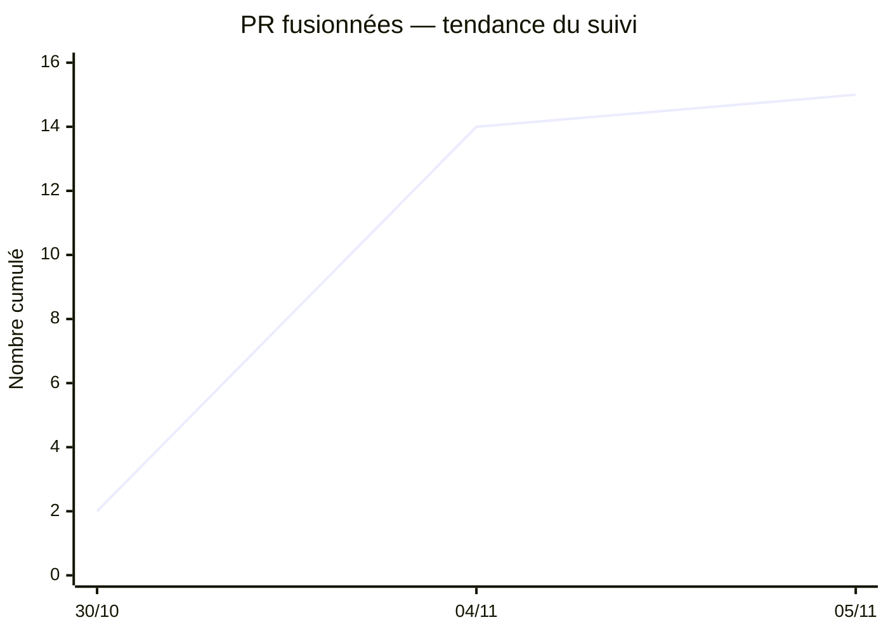

# KPI d'avancement vérifiable — tendance des PR fusionnées

**Indicateur :** nombre cumulé de Pull Requests **fusionnées** dans le dépôt `epiverse-epitech/epiverse`. Ce nombre ne mesure **pas** la proportion du projet terminée. Historique issu des dates de fusion vérifiées dans le dépôt.

| Date | PR fusionnées cumulées | Évolution depuis le relevé précédent |
|---|---:|---:|
| 30/10/2026 | **2** | baseline |
| 04/11/2026 | **14** | **+12** |
| 05/11/2026 | **15** | **+1** |

**Interprétation :** intensification des intégrations entre le 30/10 et le 04/11 ; ralentissement de l'incrément après ce point. L'augmentation de PR **ne prouve pas** l'achèvement d'un parcours complet, ni un progrès de qualité/performance.

**Preuves :** [PR fusionnées](https://github.com/epiverse-epitech/epiverse/pulls?q=is%3Apr+is%3Amerged) · [KPI et CI sur deux dates](KPI.md) · [historique détaillé](historique-livrables.md).

**KPI produit encore en attente de mesures :** [réactivité, accessibilité, FPS contextualisés](PROTOCOLE-MESURES.md), à relever sur deux snapshots comparables après mise en place du frontend.
